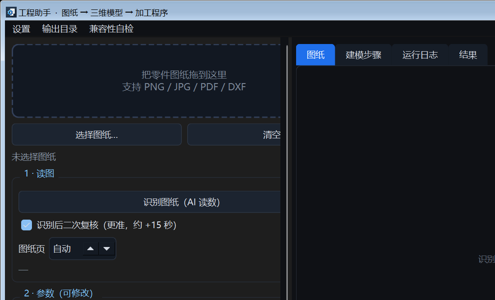

# 工程助手 · Engineering Assistant

**丢一张零件图纸进去，它自己读图、自己校验、自己建模。**

把图纸（三视图 / 照片 / PDF / DXF）交给视觉大模型读成参数，然后在后台真的打开 **UG/NX、SolidWorks**，
用真实的拉伸、切除、阵列、倒角特征把零件建出来，保存 `.prt` / `.SLDPRT` / `.STEP`。
当前版本已移除 CATIA 与加工程序生成，只保留识图、校验和 NX / SolidWorks 建模。



---

## 一、它到底解决了什么

会建模的人不缺 CAD，缺的是「照着图纸一根一根敲尺寸」的时间。这个工具把这段最枯燥的活接了过去：

| 环节 | 做的事 |
|---|---|
| 读图 | 调用视觉大模型（默认 `qwen3-vl-plus`）识别三视图尺寸、孔位、型腔、槽、沉孔；支持 PNG / JPG / PDF / DXF |
| 判断图纸类型 | 认出「这是装配图」就直接拦住建模，列出零件明细，可点选单个零件再做聚焦识别 |
| 拆步骤 | 把识别结果翻译成人的思路：「① 新建长方体 160×100×12，四角 R2 → ② 钻 Ø30 通孔 → ③ 圆周阵列 6×Ø10」，每步可改 |
| 建模 | 后台驱动对应 CAD，用真正的特征树建模并保存，不是导个网格糊弄 |
| 校验 | 建模完读 CAD 实测体积 / 质心，再解析导出的 STEP 反查长宽高与孔径孔位，偏差写进报告 |

## 二、能识别、能建模的特征

| 类别 | 特征 |
|---|---|
| 基体 | 长方体、圆柱体、矩形四角圆角 R |
| 孔 | 通孔、盲孔、沉头孔、螺纹孔（按底孔建模，保留 M 规格）、圆周均布孔、矩形阵列孔、镜像孔 |
| 槽与型腔 | 腰形槽 / 长圆槽（可带角度）、矩形型腔（可带底部圆角）、台阶 / 边缘缺口 |
| 边 | 顶面外轮廓倒角 C1 / C2、顶面外轮廓圆角 R |
| 其他 | 键槽、齿轮齿形（渐开线 400 点）、阶梯轴回转体、钣金 U 形折弯件 |

实测口径（本机 NX 12.0.2 / SolidWorks 2024）：以上特征在两款 CAD 里都能生成真实几何，
体积偏差多在 **0.000% ~ 0.2%**。详见 [`docs/验收测试报告.md`](docs/验收测试报告.md)。

## 三、建模步骤是可改的

识别不可能次次完美，所以软件没有把「识别结果」当成终点：

- 双击任意一步 → 改坐标、直径、深度、角度、数量、间距；
- 上移 / 下移 / 删除 / 临时禁用；
- 手动添加孔、型腔、槽、阵列、镜像；
- **按步骤重新建模** → 弹窗列出全部步骤，确认后严格按新参数重建，并重新做体积校验。

一句话：**图纸没标注的地方它可能猜，但猜错了你能当场改，改完它照着重建。**

## 四、本地识图 AI（离线，按内存分级）

识图模型完全在本机运行，图纸不出电脑。软件自带调用代码和便携 Ollama 运行器，
模型权重按物理内存选择：

| 物理内存 | 推荐模型 | 模型体积 | 适用情况 |
|---|---|---:|---|
| 8–15 GB | `qwen2.5vl:3b` | 3.2 GB | 基础识图；复杂图纸需人工复核 |
| 16–47 GB | `qwen2.5vl:7b` | 6.0 GB | 当前实机重点验证档，优先使用 |
| 48–95 GB | `qwen2.5vl:32b` | 21 GB | 复杂图纸；不建议 32 GB 机器默认开 |
| 96 GB 及以上 | `qwen2.5vl:72b` | 49 GB | 高精度大模型 |

安装（下载完成后永久离线，不再联网识图）：

```powershell
python scripts\install_local_ai.py            # 自动检测内存、选型并下载
python scripts\install_local_ai.py --check    # 只检查是否已装
python scripts\install_local_ai.py --list     # 查看全部档位
```

模型权重不放进 GitHub 仓库（单个 blob 约 5.5 GB，远超 GitHub 限制），
通过 Ollama 官方源下载。各档官方链接、手动命令、内存说明和验收边界见
[`docs/本地识图AI内存分级与下载.md`](docs/本地识图AI内存分级与下载.md)。

**图纸缺尺寸或自相矛盾时，软件直接报错阻断，不会让模型清洗参数、补数据或修复矛盾。**

## 五、两步校验，防止「建了个像的东西」

1. **体积 + 质心**：CAD 自己报的体积和理论体积比对（< 1% 通过）。孔位放错会立刻让质心偏。
2. **STEP 尺寸复核**：两款 CAD 都导出 STEP，再解析包围盒与每个圆柱面的半径、轴线，逐项和图纸参数对。
3. **位置出处核对**：每个特征的 x/y 标上 `dim`（图上标注）/ `pixel`（像素实测）/ `assumed`（居中假设）。
   被像素实测推翻的 `assumed` 直接阻断建模；证据原文写进 `evidence`，界面上可查。

> 局限也说清楚：整体平移型腔/槽这类错误，体积几乎不变（实测差 0.6%），只有尺寸复核和孔位出处检查能抓到。

## 六、跑起来

**环境**：Windows 10/11 64 位 + 下列任一 CAD（可多选，自动探测安装路径与模板）

- Siemens NX 12.0 及以上
- SOLIDWORKS 2022 及以上

**源码运行**

```bash
pip install -r requirements.txt
python main.py
```

**自己打包 exe**

```bash
pyinstaller --noconfirm --clean 工程助手.spec
```

产物在 `dist/工程助手/工程助手.exe`（onedir 模式，`_internal` 是依赖目录，别单独拷 exe）。

**API 配置**：默认读 `%USERPROFILE%\.codex\config.toml` 里的 `base_url` 与 `experimental_bearer_token`，
也可以在界面「设置」里填，存到 `%APPDATA%\EngineeringAssistant\settings.json`。任何 OpenAI 兼容的视觉模型端点都能用。

**命令行自检**（不弹界面，跑完整链路）

```bash
工程助手.exe --selftest <图纸路径> <输出目录> NX,SolidWorks
```

## 七、已知问题 / 能力边界

这个项目是按「能真跑通」写的，不是按「Demo 好看」写的，所以问题都摊开讲：

1. **识图本身还不稳**。同一张零件图连跑，特征数会在 3 / 6 / 7 之间飘，孔位 y 有 25 / 38 两种结果。
   现在已经加了「重复孔」「孔位到边距离必须有图面出处」的判据，会降置信度并报 `blocking` / `uncertain`，
   **错的不会再流到 CAD**，但让识别本身稳定还需要继续做。
   另外从 2026-11，**没标注的位置不再默认居中**：程序按图上外形标定 px/mm，用像素实测把
   型腔/槽/孔的中心量出来（实测精度 ±0.2mm），与模型值不符就阻断；界面参数表新增「位置出处」
   一列（标注 / 实测 / 假设），悬停能看到换算依据。回归用 `python tests/test_position_source.py`（28 项，全离线）。
2. **装配图不支持**。识别到装配图直接阻断——实测同一张装配图 7 次给出 7 组不同尺寸，与其瞎建不如不建。
3. **曲面、复杂箱体内部结构、自动装配**不做，定位是零件建模 + 出程序。
5. **SolidWorks 在可用内存不足时会静默失败**（特征返回空但体积还在算），已加内存前置判定，低内存直接拒跑。
6. 版本兼容靠**运行时探测 API**，不是写死版本号；但本机只实测了 NX 12.0.2 / SW 2024，
   更新的版本请先点工具栏「兼容性自检」看探测结果。
7. `tools/` 里两千多个一次性调试脚本没有随仓库发布；CATIA 适配器和 CAM/NC 模块已从当前版本删除。

## 八、目录

```
main.py                  入口（GUI / --selftest）
工程助手.spec            PyInstaller 打包配置
app/
  config.py              配置与 API、CAD 路径探测
  models.py              PartSpec 数据模型（基体 + 特征）
  vision.py              图纸识别、二次复核、一致性判据
  measure.py             图纸像素实测（位置出处：dim / pixel / assumed）
  calc.py / geom.py      几何与体积计算
  steps.py               建模步骤生成
  stepcheck.py           STEP 解析与尺寸复核
  pipeline.py            识别 → 步骤 → 建模 → CAM 编排
  cad/  nx.py sw.py base.py guard.py            两套 CAD 适配器 + 单实例闸门
  cam/  gcode.py plan.py verify.py ...           刀路、工艺、NC 校验
  ui/   main_window.py   界面
docs/                    使用说明、功能清单、验收报告、已知问题
samples/                 测试图纸与期望结果
assets/                  图标
```

## 九、说明

本项目的代码、适配器实现与测试数据由 **Codex** 在该机器上迭代完成，本文的介绍、能力清单与限制说明，
是根据它的开发日志、`功能清单.md`、`验收测试报告.md` 与 `ISSUES_TOKENEXT.md` 整理并适当改写而来。
CAD 的 COM / NXOpen 接口细节都以本机实测为准，换机器可能需要重新跑「兼容性自检」。

**请把它当研究性工具用**：涉及真实生产前，务必核对模型尺寸与 NC 程序，不要直接上机。

---

**本项目仍是半成品。**
